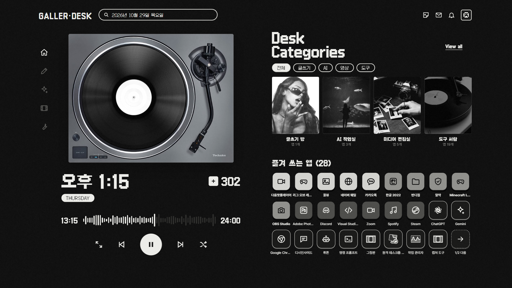

# DESK — 흑백 턴테이블 바탕화면

**소개 페이지 (움짤 포함): https://casajeon-wq.github.io/desk/**

턴테이블이 도는 흑백 바탕화면이에요. **내 바탕화면에 있던 앱을 알아서 읽어서** 흑백 아이콘으로 바꿔 띄우고, 누르면 그 앱이 실제로 열려요.

- 카톡·디스코드·스팀·한글·크롬·포토샵·롤 같은 흔한 앱 **300개쯤(이름 낱말 389개)은 전용 선 아이콘**으로 바꿔요
- 사전에 없는 앱은 **진짜 아이콘을 색 분리**해서 같은 흑백 톤으로 바꿔요
- **많이 쓰는 앱일수록 밝게, 앞쪽에** 놓아요 (윈도우 실행 기록을 내 PC 안에서만 읽어요)
- 시계·하루 진행 막대·포스트잇 메모(바탕화면에 바로 글 쓰기) · 검은 바탕(OLED 화면이면 전기도 덜 씀)
- 배터리로 쓸 땐 움직임이 멈추고, 다른 창이 화면을 다 덮으면 Lively가 쉬어요

## 설치 (3분)

1. 위쪽 초록 **Code → Download ZIP** → 압축 풀기
2. **`설치.bat`** 더블클릭
   - Lively가 없으면 알아서 깔아요 (무료 · 약 210MB). winget으로 깔고, 안 되면 Lively 공식 GitHub에서 최신 설치 파일을 받아 조용히 깔아요. 관리자 허락 창이 뜨면 "예"
   - 파란 경고창이 뜨면 **추가 정보 → 실행**
3. 끝! `Win + D`로 바탕화면을 보세요

## 쓰는 법

| 하고 싶은 것 | 방법 |
|---|---|
| 앱 열기 | 아이콘 한 번 누르기 |
| 분류별로 보기 | 왼쪽 세로 아이콘 · `전체/글쓰기/AI/영상/도구` 칸 · 재생 버튼 옆 ◀ ▶ |
| 턴테이블 멈추기 | 턴테이블이나 가운데 재생 버튼 |
| 메모 붙이기 | 오른쪽 위 메모 아이콘 → A 종이 / B 타일 / C 라벨 → 바로 타자 (치는 대로 저장돼서 컴퓨터를 꺼도 남아요) |
| 메모 글 고치기 | 보통 메모장처럼: 누른 자리에 커서 · 끌어서 고르기 → Backspace·타자 · 두 번 누르기 = 낱말 · 화살표·Shift·Home/End · `Ctrl+A/C/X/V/Z/Y` |
| 메모 옮기기·떼기 | 끌어서 옮기기 · 마우스 올리면 나오는 `떼기` 두 번 |
| 앱이 27개보다 많을 때 | 마지막 칸 `→ 다음` |
| 새 앱·바로가기 넣기 | 새로 깐 앱은 알아서 들어와요. 직접 넣고 싶으면 맨 끝 **`바탕화면`** 칸 → 열린 폴더에 바로가기·폴더를 끌어다 놓기 → 20초쯤 뒤 알아서 생겨요 |
| 아이콘 빼기 | 같은 폴더에서 그 바로가기를 지우면 20초쯤 뒤 사라져요 |
| 바로 다시 읽기 | `바탕화면 다시 읽기.bat` (기다리기 싫을 때) |
| 원래대로 | **`제거.bat`** (바탕화면 아이콘·Lively 설정 되돌림, 메모는 문서 폴더에 백업) |

원래 바탕화면 아이콘은 숨겨질 뿐 파일은 그대로 있어요. 바탕화면에 있던 사진·문서 같은 낱개 파일은 맨 끝 **`바탕화면`** 칸을 누르면 폴더로 열려요.

## 손으로 고치기

`%LOCALAPPDATA%\DeskWallpaper\apps.js`를 메모장으로 열어서:

- `"hidden": true` → 그 앱 숨기기
- `"tier": 1` ~ `3` → 밝기(1이 제일 밝음), 줄 순서 = 화면 순서
- `"group"` → `ai` / `write` / `film` / `tool`
- `"logo"` → 왼쪽 위 글자 (처음엔 윈도우 사용자 이름)

고친 뒤엔 Lively에서 배경을 한 번 다시 눌러 주세요. (`바탕화면 다시 읽기.bat`은 바탕화면을 새로 읽어서 손으로 고친 순서를 덮어써요)

## 이렇게 돌아가요

- **배경** = Lively가 띄우는 웹페이지 (`wallpaper/`)
- **실행 도우미** = 아이콘을 누르면 앱을 여는 작은 PowerShell 스크립트 (`helper/helper.ps1`). 설치 말고 따로 깔 건 없어요.
  - 내 PC 안(127.0.0.1:47331)에서만 듣고, 설치 때 만든 비밀 토큰이 맞을 때만, 목록에 있는 바로가기만 열어요
  - 시작프로그램에 `DESK 도우미`로 들어가요
- **바탕화면 읽기** = `setup/scan.ps1` + 앱 사전 `setup/known-apps.json` (사전에 앱을 더 넣고 싶으면 PR 환영)

## 안 될 때

- **아이콘을 눌러도 안 열려요** → 실행 도우미가 꺼진 거예요. 컴퓨터를 한 번 다시 켜거나 `설치.bat`을 다시 누르세요
- **스토어판 Lively** → 자동 적용이 안 될 수 있어요. Lively 열기 → 라이브러리에서 `DESK` 누르기
- **메모에 한글이 이상하게 쳐져요** → 쓰는 중인 메모 오른쪽 위 동그라미 `가/A`를 눌러 바꾸세요 (한/영 키도 돼요)

---
글꼴: [Galmuri](https://github.com/quiple/galmuri)·[Pretendard](https://github.com/orioncactus/pretendard) (SIL OFL) · 3D: [three.js](https://threejs.org) (MIT) · 사진: 원작자에게 허락을 받았어요
